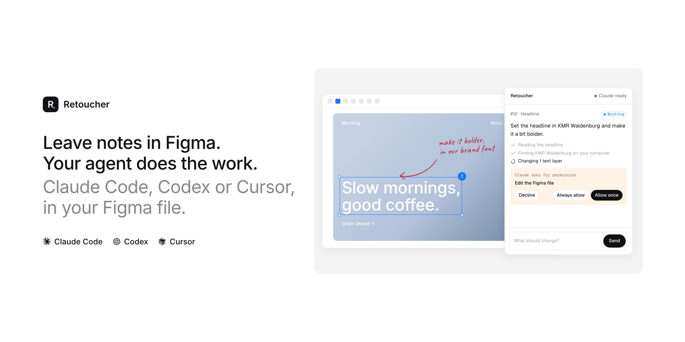

# Retoucher



Leave notes in Figma, your coding agent does the work. Select a layer (or mark an area like a comment), write what should change, press Send. The agent picks the note up, edits the file through the Figma MCP, shows its steps live, asks its questions and permissions in the same panel and answers there. Undo and before/after pictures included.

Works with **Claude Code**, **Codex** and **Cursor**. Website: [retoucher.alicorak.com](https://retoucher.alicorak.com/)

```
Figma panel  ──▶  bridge on your computer (localhost:4747)  ◀──  Claude Code / Codex / Cursor
                  notes, screenshots, questions, permissions       edits Figma through the Figma MCP
```

Two parts, installed once:

1. **Agent plugin** (Claude Code, Codex or Cursor): starts the bridge, teaches the agent how to handle notes, routes its questions and permission prompts to the panel.
2. **Figma plugin**: the panel you write notes in.

## Requirements

- [Claude Code](https://claude.com/claude-code), [Codex](https://developers.openai.com/codex) or [Cursor](https://cursor.com) with the **Figma MCP server** connected, and edit access to the Figma files you want to change
- [Node.js](https://nodejs.org) 18 or newer
- Figma desktop app or browser (in a browser, allow it to reach your computer if it asks)

## Install

### 1. Agent plugin

**Claude Code.** In a terminal:

```bash
claude plugin install retoucher --marketplace alicorak/retoucher
```

Or inside Claude Code: `/plugin marketplace add alicorak/retoucher`, then `/plugin install retoucher@retoucher`. In the Claude desktop app: **+ → Plugins** works too. It is installed for you, not for one project, so it works in whatever folder you open Claude Code in.

**Codex.** In a terminal:

```bash
codex plugin marketplace add alicorak/retoucher
```

Then install **Retoucher** from `/plugins` in the Codex CLI (or the Plugins tab of the desktop app) and start a new session. Codex asks you to review and trust the plugin's hooks once; they ask permission prompts in the Figma panel. The note tools come from the plugin's `retoucher` MCP server, so Codex's sandbox doesn't need network access.

**Cursor.** Until the plugin is in the Cursor Marketplace, install it from GitHub:

```bash
git clone https://github.com/alicorak/retoucher.git ~/.retoucher-plugin
mkdir -p ~/.cursor/plugins/local && ln -s ~/.retoucher-plugin ~/.cursor/plugins/local/retoucher
```

Restart Cursor. The plugin adds the `retoucher` MCP server, the skills, and a hook that asks Figma MCP approvals in the panel while the agent works on a note. Update later with `git -C ~/.retoucher-plugin pull`.

**Coming from `figma-annotate` (0.7 or older)?** The plugin is now called `retoucher`. Remove the old one (`claude plugin uninstall figma-annotate`, or in Cursor delete the `~/.cursor/plugins/local/figma-annotate` link) and install it again as above. Your notes, pairing and Figma token move from `~/.figma-annotate` to `~/.retoucher` on their own.

### 2. Figma plugin

Install [Retoucher from Figma Community](https://www.figma.com/community/plugin/1696122599848660328/retoucher) and run it from Figma's plugins. The first time it connects, the panel pairs with the bridge on your computer (see *Privacy*).

### 3. Start watching

- **Claude Code**, any folder: `/retoucher:watch`
- **Codex** or **Cursor** (Agent): ask it to "watch my Figma notes" (the `watch-figma-notes` skill)

The panel's top-right tells you where things stand:

| Panel | Meaning |
| --- | --- |
| 🟢 Claude ready | An agent is watching; notes are picked up right away |
| 🟡 Not watching | The bridge runs, but no agent watches. Notes wait until you start watching |
| 🔴 Not connected | No agent session is open (opening one starts the bridge), or the agent plugin isn't installed |
| Not paired | Another Figma panel is paired with this bridge; ask the agent to run `retoucher unpair` |

## Using it

1. Select one or more layers in Figma (or nothing, for the whole page).
2. Write the change in the box at the bottom of the panel.
3. Press **Send** (↵). Shift+Enter starts a new line.

Notes read like a chat, newest at the bottom. Each one shows its status: *Waiting → Claude is working → Done*, or *Needs your answer* when Claude has a question. Answer in the box under the note. Click a note to jump to its layers in Figma.

Tip: select the specific layer you mean. A selection that covers a whole row of screens is ambiguous, and Claude will ask what you meant.

## Features

- **Quick action:** press ⌘/ in Figma, type "Retoucher", Tab, write the note, Enter. It goes out with the current selection without opening anything else.
- **Chat with every note:** write under any note at any time, also while Claude is working. Claude gets the message right away.
- **@mentions:** type `@` in the note to pick a variable, style, component or library. Claude uses exactly those. Library components show up once they are used on the page.
- **Design system:** *Any library* / *This file only* / a library name tells Claude what to build with. Claude builds from the file's components and variables, follows a Figma Spec if there is one, and uses hard-coded values only when nothing fits.
- **Versions:** pick 2–4 and Claude makes that many different directions side by side, leaving the original alone.
- **Whole page or whole file:** send a note with nothing selected and it is about the page. *Options → Applies to → Whole file* makes it about every page of the file ("all headings above 32 pt in Druk", "dark mode for every screen").
- **Questions and plans in the panel:** when Claude asks a multiple-choice question or wants a plan approved, it shows as a card in the panel. Pick answers (or write your own) and send, or *Approve plan* / *Change* with a note. Turn on *Options → Show a plan first* to see Claude's plan before anything changes.
- **Model and skill per note:** *Options → Model* lists the models the watching agent can hand a note to, by their full names (for Claude Code: Claude Opus, Sonnet, Haiku, Fable); the chosen one works on the note as a helper agent. It's hidden when the agent can't pick a model. *Options → Skill* lists the skills of the Claude Code session that is watching.
- **Permissions in the panel:** when the agent needs permission for a tool while working on a note, the question shows in the panel: *Allow once*, *Always allow* or *Decline*. In Cursor this covers MCP tools (the Figma edits); shell commands are still approved in Cursor. No need to go back to the agent. If the panel is closed, no note is being worked on, or nobody answers within 2 minutes, the agent asks in its own window as usual. *Always allow* saves the same rule the terminal's "don't ask again" would. The plugin's own `retoucher` command (it only talks to the local bridge) runs without asking.
- **References from Mobbin:** *Options → Mobbin refs* (4, 8 or 12): the agent first finds matching screens on Mobbin, puts them next to your selection and shows them in its reply as thumbnails that open on Mobbin, then makes the change on a copy. Needs the Mobbin MCP connected to the agent.
- **Your local fonts:** the Figma MCP can't load fonts installed on your computer (Druk, KMR Waldenburg, …), so it can't touch text set in them. The agent sends those changes to the panel instead, which runs them inside your Figma: font family (keeping each weight), size, letter spacing, line height, with Undo. Keep the panel open in that file.
- **Live progress:** while Claude works, the note shows the step it is on and the last ones it finished. Afterwards they fold into "N steps".
- **Selecting opens the note:** select a layer on the canvas and the note about it is highlighted in the panel.
- **Options:** scope, versions, design system, comments, model, skill, plan first, urgent and canvas markers sit behind *Options*. The button shows what is switched on.
- **Batch:** *Add to batch* (⇧⌘↵) collects several notes, *Send all* delivers them together. Claude handles them in order, or *At the same time* when they don't depend on each other.
- **Canvas markers:** each open note adds a native Figma annotation ("Claude #3 · Waiting") on its layers. It updates with the status and disappears when the note is done or deleted. Toggle with *Show markers on canvas*. Other people's annotations are never touched.
- **Several targets:** *Add selection* collects layers and frames, on any page, into the note. Each keeps its own screenshot. Nothing added: the current selection is used.
- **Areas:** select a frame (or nothing, for what is on screen) and press *Mark area*. A big picture opens in the panel: drag to mark an area, click to drop a pin, then *Add*. Claude gets each area's crop, its position, the screen it sits in and the layer underneath, like a pinned Figma comment.
- **Figma comments:** *Options → Comments → Apply* makes the changes the open comment threads on those layers ask for. *Summarize* groups them into themes, flags conflicts and proposes a plan you approve first (needs a Figma token, see below).
- **Files:** add up to 8 files per note (12 MB each): photos, PDFs, text, anything. Drop them anywhere on the panel, paste (screenshots included), or use *Add file*. Photos are scaled to 1600 px.
- **Before / after + Undo:** finished notes show a before and after picture. *Undo change* restores the old values Claude recorded before editing (works without Claude being online): layer properties, styles, instance properties and swaps, variable bindings, variables, moved layers and new layers. Changes Claude couldn't record show no Undo button.

### Figma comments

Reading comments goes through Figma's REST API and needs a personal access token (Figma → Settings → Security → Personal access tokens, scope *File comments: read*). Pick *Apply* or *Summarize* under *Options → Comments* and paste it into the field that appears. It is stored on your computer only, in the plugin's data folder.

## How the agent handles a note

The procedure is the plugin's `handle-figma-notes` skill ([skills/handle-figma-notes/SKILL.md](skills/handle-figma-notes/SKILL.md)). Claude Code uses the `retoucher` command, which is on its PATH while the plugin is enabled. Codex and Cursor use the same commands as tools of the `retoucher` MCP server (`wait_for_note`, `claim_note`, `add_step`, `finish_note`, `ask_designer`, …).

| Command | What it does |
| --- | --- |
| `list [status]` | Notes by status (default `pending`) |
| `show <id>` | Full detail: file key, layer IDs, screenshot paths, Figma URL |
| `claim <id>` | Mark as working |
| `step <id> "msg"` | Live progress line under *Working* in the panel |
| `plan <id> "plan"` | Show a plan with *Approve plan* / *Change something*, and wait |
| `skills '<json>'` | Tell the panel which skills this session has |
| `fonts <id> [query]` | Fonts installed on the designer's computer (run by the panel) |
| `text <id> '<json>'` | Change text through the panel, local fonts included; Undo recorded |
| `done <id> "msg"` | Reply and mark done |
| `ask <id> "question"` | Reply and ask the designer something |
| `say <id> "msg"` | Reply without changing status |
| `edit <id> "msg"` | Rewrite Claude's last reply on the note |
| `snapshot <id> before\|after <png>` | Store a before/after screenshot shown in the panel |
| `patch <id> <json>` | Store the revert patch behind the Undo button |
| `focus <id> <json>` | Layers to select; the panel shows a *Select N layers* button |
| `comments <fileKey\|id> [--all]` | The file's open Figma comment threads (needs a token) |
| `unpair` | Forget the paired Figma panel, so another one can pair |
| `watch` | One line per new note, follow-up or message (for a Claude Code Monitor) |

## Troubleshooting

| Symptom | Fix |
| --- | --- |
| Panel says "Not connected" | Open Claude Code; the plugin starts the bridge when a session starts. Check `curl localhost:4747/health` |
| Panel says "Not paired" | Another Figma panel (another computer account or a reinstall) paired first. In Claude Code: `retoucher unpair`, then reopen the panel |
| Notes stay "Waiting" | Panel says "Not watching": run `/retoucher:watch` |
| Port 4747 is used by another program | Claude Code says so at session start. Free the port |
| Claude can't edit the file | The Figma MCP isn't connected in Claude Code, or your Figma seat has no edit access to the file |
| Send button stays disabled | Needs a note and the file's link: paste the file URL when the panel asks (once per file) |

## Privacy

Everything stays on your computer. The bridge listens on `localhost` only and keeps notes, screenshots and files in `~/.retoucher`, shared by every agent. The Figma plugin talks to that bridge and nothing else.

Websites you visit can also reach `localhost`, so the bridge only answers a page that carries the key of the Figma panel that paired with it first. Without it, a page can't read your notes, send notes or answer permission prompts. Claude Code and its hooks run on your computer and need no key.

## Development

Run the bridge from a checkout with `./start.sh` (notes go to `data/`), import `plugin/manifest.json` in the Figma desktop app (**Plugins → Development → Import plugin from manifest…**), and load the Claude Code plugin from the folder with `claude --plugin-dir .`. The MCP server (`bridge/mcp-server.mjs`) speaks MCP over stdio with no dependencies; `codex plugin marketplace add ./` installs the checkout in Codex.

## License

[MIT](LICENSE)
